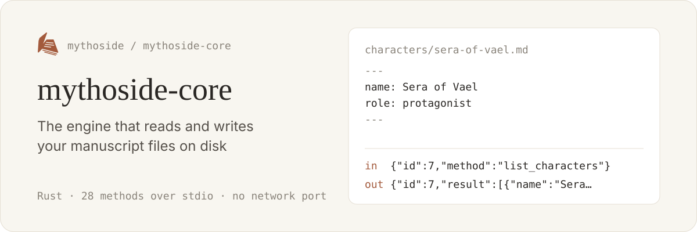

<p align="center">
  
</p>

<p align="center">
  <a href="https://github.com/mythoside">Mythos</a> · <a href="https://github.com/mythoside/mythoside-ts">Masaüstü uygulaması</a> · <a href="https://mythoside.com">mythoside.com</a> · <a href="./README.md">English</a> · Türkçe
</p>

<p align="center">
  <a href="./LICENSE.md"></a>
</p>

Seri yazmak için bir masaüstü uygulaması olan [Mythos](https://github.com/mythoside)'un motoru. Müsvedde onun sorumluluğunda: veri modeli, Markdown + YAML dosya formatı, dosya izleme ve bir seri, kitap, bölüm, karakter, mekân ya da not üzerindeki her oluşturma, okuma, güncelleme ve silme işlemi. Arayüzü yok, Tauri'ye bağımlı değil.

> **Erken geliştirme aşamasında.** Format, dosya izleyici ve RPC sunucusu çalışıyor ve testleri var. Süreklilik kontrolleri sıradaki iş ve henüz bu repoda yok. Bir arama dizini planlanıyor.

## Neyi okuyup yazar

Bir seri bir klasördür. Başka hiçbir yerde bir şey tutulmaz.

```text
the-ashfall-cycle/
├── series.yaml
├── embergate/
│   ├── book.yaml
│   └── chapters/
│       └── 12-the-fall.md
├── the-drowned-throne/
│   ├── book.yaml
│   └── chapters/
│       ├── 1-saltlight.md
│       └── 3-the-tidewatch.md
├── characters/
│   ├── lord-corvath.md
│   └── sera-of-vael.md
├── locations/
└── notes/
```

Her varlık bir Markdown dosyasıdır: alanları YAML frontmatter'da, metni ya da biyografisi gövdede durur.

## Uygulama onunla nasıl konuşur

Motor uygulamanın alt süreci olarak çalışır. stdin'den satır başına bir JSON isteği okur, stdout'a tek satırlık bir yanıt yazar:

```text
in   {"id": 7, "method": "list_characters", "params": {"projectDir": "…"}}
out  {"id": 7, "result": [ … ]}
```

`id` taşımayan satırlar, diskte bir dosya değiştiğinde dosya izleyicinin gönderdiği olaylardır. Motor hiçbir zaman ağ portu açmaz; ona yalnızca onu başlatan süreç ulaşabilir. Ayrı bir süreç olması, buradaki `cargo test`'in pencereye, webview'a ya da arayüze ihtiyaç duymaması anlamına da gelir.

<details>
<summary>28 metodun tamamı</summary>

| Varlık | Metotlar |
| --- | --- |
| Seri | `create_series` `get_series` `list_series` `update_series` `delete_series` |
| Kitap | `create_book` `list_books` `delete_book` |
| Bölüm | `create_chapter` `list_chapters` `update_chapter` `update_chapter_content` `move_chapter` `delete_chapter` |
| Karakter | `create_character` `list_characters` `update_character` `delete_character` |
| Mekân | `create_location` `list_locations` `update_location` `delete_location` |
| Not | `create_note` `list_notes` `update_note` `delete_note` |
| İzleyici | `start_watching` `stop_watching` |

</details>

## Derleme ve test

```bash
cargo build   # kütüphane + mythoside-core binary'si
cargo test    # format, izleyici ve RPC testleri
```

Uygulamanın kendisini çalıştırmak için [`mythoside-ts`](https://github.com/mythoside/mythoside-ts) reposunu kullan. Bu binary'yi derleyip Tauri sidecar'ı olarak paketler.

## Klasör yapısı

```text
crates/common/      slugify, zaman damgaları
crates/narrative/   alan modeli: Series, Book, Chapter, Character, Location, Note
crates/parser/      Markdown + YAML frontmatter okuma ve yazma
crates/workspace/   dosya işlemleri ve dosya izleyici
crates/rpc/         stdin/stdout istek döngüsü
docs/architecture/  hangi crate'e ne girer, ne girmez
```

## Lisans

[Functional Source License 1.1, ALv2 Future License](./LICENSE.md) ile kaynak kodu erişilebilir. Kendi yazın için de dahil olmak üzere kullanabilir, okuyabilir, değiştirebilir ve kendi bilgisayarında barındırabilirsin. Rakip bir ticari ürün ya da hizmet olarak sunamazsın. Her sürüm yayımlandıktan iki yıl sonra Apache 2.0'a dönüşür. Mythos adı ve logosu lisansın kapsamında değildir.

[Katkı](https://github.com/mythoside/.github/blob/main/CONTRIBUTING.md) · [Güvenlik](https://github.com/mythoside/.github/blob/main/SECURITY.md) · [Discussions](https://github.com/mythoside/mythoside-core/discussions)
