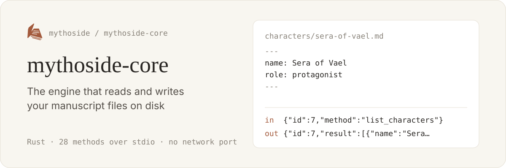

<p align="center">
  
</p>

<p align="center">
  <a href="https://github.com/mythoside">Mythos</a> · <a href="https://github.com/mythoside/mythoside-ts">Desktop app</a> · <a href="https://mythoside.com">mythoside.com</a> · English · <a href="./README.TR.md">Türkçe</a>
</p>

<p align="center">
  <a href="./LICENSE.md"></a>
</p>

The engine behind [Mythos](https://github.com/mythoside), a desktop app for writing a series. It owns the manuscript: the data model, the Markdown + YAML file format, file watching, and every create, read, update and delete on a series, book, chapter, character, location or note. It has no UI and no Tauri dependency.

> **Early development.** The format, the file watcher and the RPC server work and are tested. The search index and continuity checks are not started yet.

## What it reads and writes

A series is a folder. Nothing lives anywhere else.

```text
the-ashfall-cycle/
├── series.yaml
├── embergate/
│   ├── book.yaml
│   └── chapters/
│       └── 12-the-fall.md
├── the-drowned-throne/
│   ├── book.yaml
│   └── chapters/
│       ├── 1-saltlight.md
│       └── 3-the-tidewatch.md
├── characters/
│   ├── lord-corvath.md
│   └── sera-of-vael.md
├── locations/
└── notes/
```

Each entity is a Markdown file whose YAML frontmatter holds its fields and whose body is the prose or bio.

## How the app talks to it

The engine runs as a child process of the app and reads one JSON request per line on stdin, then answers with one line on stdout:

```text
in   {"id": 7, "method": "list_characters", "params": {"projectDir": "…"}}
out  {"id": 7, "result": [ … ]}
```

Lines without an `id` are events from the file watcher, sent when a file changes on disk. The engine never opens a network port, so only the process that started it can reach it. Keeping it a separate process also means `cargo test` here needs no window, no webview and no UI.

<details>
<summary>All 28 methods</summary>

| Entity | Methods |
| --- | --- |
| Series | `create_series` `get_series` `list_series` `update_series` `delete_series` |
| Book | `create_book` `list_books` `delete_book` |
| Chapter | `create_chapter` `list_chapters` `update_chapter` `update_chapter_content` `move_chapter` `delete_chapter` |
| Character | `create_character` `list_characters` `update_character` `delete_character` |
| Location | `create_location` `list_locations` `update_location` `delete_location` |
| Note | `create_note` `list_notes` `update_note` `delete_note` |
| Watcher | `start_watching` `stop_watching` |

</details>

## Build and test

```bash
cargo build   # library + the mythoside-core binary
cargo test    # format, watcher and RPC tests
```

To run the app itself, use [`mythoside-ts`](https://github.com/mythoside/mythoside-ts). It builds this binary and bundles it as a Tauri sidecar.

## Layout

```text
crates/common/      slugify, timestamps
crates/narrative/   the domain model: Series, Book, Chapter, Character, Location, Note
crates/parser/      Markdown + YAML frontmatter in and out
crates/workspace/   file operations and the file watcher
crates/rpc/         the stdin/stdout request loop
docs/architecture/  what belongs in each crate and what doesn't
```

## License

Source-available under the [Functional Source License 1.1, ALv2 Future License](./LICENSE.md). You can use, read, modify and self-host it, including for your own writing. You can't offer it as a competing commercial product or service. Each release becomes Apache 2.0 two years after it ships. The Mythos name and logo are not covered by the license.

[Contributing](https://github.com/mythoside/.github/blob/main/CONTRIBUTING.md) · [Security](https://github.com/mythoside/.github/blob/main/SECURITY.md) · [Discussions](https://github.com/mythoside/mythoside-core/discussions)
